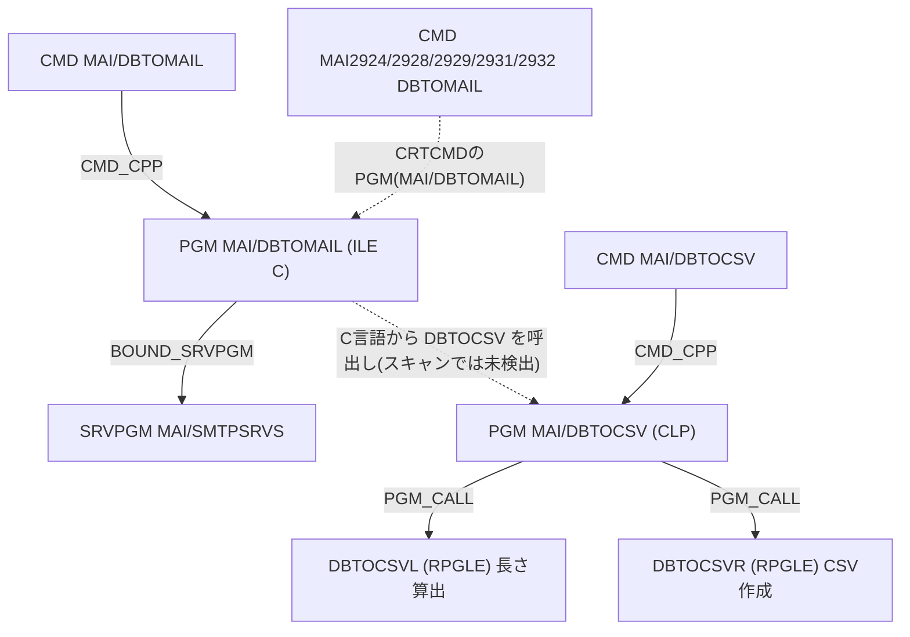

# DBTOMAILコマンドにファイル形式パラメーターを追加する場合の修正箇所

## 前提と確認事項

- 対象アプリは Understand の `MAI/400`(APP_ID 5)です。最終スキャンは6日前(2026-10-08)です。
- 「ファイル形式」は、添付ファイルの出力形式を選ぶパラメーターと解釈しました。例は `FORMAT(*CSV *TSV …)` です。
  - 形式の候補(TSV、固定長など)は未確認です。
  - 形式が変わるのが区切り文字だけなのか、引用符や拡張子も変わるのかで、DBTOCSV系の修正範囲が変わります。
- パラメーターを追加するだけでなく、**パラメーターに応じて出力内容を変える**前提で整理しています。

## 1. Understand の解析結果

| 項目                                                      | 結果                                                                                         |
| --------------------------------------------------------- | -------------------------------------------------------------------------------------------- |
| CMD `MAI/DBTOMAIL`                                        | 被依存は0件で、処理プログラム(CPP)は `DBTOMAIL` です。                                       |
| PGM `MAI/DBTOMAIL`                                        | 被依存は CMD_CPP の1件のみです。ILE の C 言語プログラムで、`SMTPSRVS` をバインドしています。 |
| SRVPGM `SMTPSRVS`                                         | 被バインド(BOUND_SRVPGM)は3件です。エクスポートは26個(`SMTPMpartAttach` など)です。          |
| 他言語版 CMD(MAI2924、MAI2928、MAI2929、MAI2931、MAI2932) | 同名の `DBTOMAIL` コマンドが5つあります。Understand 上は依存0件です。                        |
| `DBTOCSV` PGM                                             | 被依存は CMD_CPP の1件で、`DBTOCSVL` と `DBTOCSVR` を呼びます。                              |

Understand 上の依存関係は浅く、**影響範囲は DBTOMAIL 自身と DBTOCSV 系にほぼ閉じています**。ただし次の依存は Understand に出ません。ソースで確認しました。

- C 言語から `DBTOCSV` を呼ぶ処理は、`#pragma linkage(DBTOCSV,OS)` で行っています。
- 他言語版コマンドが `PGM(MAI/DBTOMAIL)` を共有していることは、`CRTCMD` 文に書かれています。
- メッセージ、ヘルプ、ビルド CL の関係もソース上の参照です。

## 2. 必要な修正(ソース確認済み)

### A. 必須修正

| #   | 対象(MAIV300S)                                                                                                                                          | 修正内容                                                                                                                                                                                        |
| --- | ------------------------------------------------------------------------------------------------------------------------------------------------------- | ----------------------------------------------------------------------------------------------------------------------------------------------------------------------------------------------- |
| 1   | [`QCMDSRC/DBTOMAIL.CMD`](/MAIV300S/QCMDSRC/DBTOMAIL.CMD)                                                                                                | `PARM KWD(FORMAT)` を追加します。例は `TYPE(*CHAR) LEN(10) RSTD(*YES) DFT(*CSV) SPCVAL(...) PROMPT(DBT02xx nnn)` です。                                                                         |
| 2   | [`QCSRC/DBTOMAIL.C`](/MAIV300S/QCSRC/DBTOMAIL.C:104)                                                                                                    | 冒頭のコメントに「argv は CMD の PARM 定義順」とあります。FORMAT 用のグローバル変数(`PFORMAT[11]`)を追加し、`main` の `argv` 取得に `memcpy(PFORMAT, argv[n], 10)` を追加します。               |
| 3   | 同上(行184付近)                                                                                                                                         | `DBTOCSV(...)` 呼び出しに形式を渡す必要があります。下記 B を参照してください。                                                                                                                  |
| 4   | 同上(行165〜181、行324〜325)                                                                                                                            | 添付名 `wAtname` の拡張子が `".csv"` 固定です(行170)。`SMTPMpartAttach` の Content-Type も `"application/octet-stream"` 固定です。形式に応じて拡張子(`.tsv` など)と MIME タイプを切り替えます。 |
| 5   | 同上(`SMTPMpartText` 付近、行313〜320)                                                                                                                  | 本文に出力する情報に形式を追加するかを判断します(任意)。                                                                                                                                        |
| 6   | [`QCLSRC/CRTMAIMSG.CLP`](/MAIV300S/QCLSRC/CRTMAIMSG.CLP:414) と [`QMAKESRC/ADBMSG.CLP`](/MAIV300S/QMAKESRC/ADBMSG.CLP:353)                              | 新しい DBT0xxx 番号のプロンプト・メッセージ(日本語)を追加します。DBT0210 の次が未使用か確認が必要です。                                                                                         |
| 7   | 言語別メッセージ: `CRTMAI24`、`CRTMAI28`、`CRTMAI29`、`CRTMAI31`、`CRTMAI32` の各 `.CLP` と [`QMAKESRC/ADBMSG2.CLP`](/MAIV300S/QMAKESRC/ADBMSG2.CLP:91) | 同じメッセージ ID を各言語の `MAIMSG`(MAI2924〜MAI2932)に追加します。DBT0210 の記述が各ファイルにあります。                                                                                     |
| 8   | [`QHLPSRC/DBTOMAIL.PNLGRP`](/MAIV300S/QHLPSRC/DBTOMAIL.PNLGRP:154)                                                                                      | `:help name='DBTOMAIL/FORMAT'.` を追加します。パラメーター順にヘルプが並んでいるため、CMD の定義位置に合わせて挿入します。                                                                      |
| 9   | `QHLPSRC037`、`QHLPSRC273`、`QHLPSRC280`、`QHLPSRC284`、`QHLPSRC297`                                                                                    | 他言語のヘルプ(PNLGRP)を保守している場合は、同様に追加します。今回の検索では DBTOMAIL\* は該当なしでした。                                                                                      |

### B. 形式によって出力内容が変わる場合の DBTOCSV 系修正

`DBTOCSV` は `DBTOMAIL.C` から呼ばれる CLP です。現在は8個の固定引数(`PFILE`、`*STMF`、`PMBR`、`*REPLACE`、`*YES`、`wStmf`、`PFROMCCSID`、`PTOCCSID`)を渡しています。

| #   | 対象                                                                 | 修正内容                                                                                                                                                                |
| --- | -------------------------------------------------------------------- | ----------------------------------------------------------------------------------------------------------------------------------------------------------------------- |
| 10  | [`QCMDSRC/DBTOCSV.CMD`](/MAIV300S/QCMDSRC/DBTOCSV.CMD)               | `FORMAT` 相当の PARM を追加します。                                                                                                                                     |
| 11  | [`QCLSRC/DBTOCSV.CLP`](/MAIV300S/QCLSRC/DBTOCSV.CLP:1)               | `PGM PARM(...)` と `DCL` に変数を追加し、`DBTOCSVR` / `DBTOCSVL` へ形式を渡します。                                                                                     |
| 12  | [`QRPGLESRC/DBTOCSVR.RPGLE`](/MAIV300S/QRPGLESRC/DBTOCSVR.RPGLE:151) | 区切り文字 `','` と引用符 `'"'` が固定です。`*ENTRY PLIST` がないため追加が必要です。`DBTOCSVR` は引数なしで呼ばれ、入出力は `OVRDBF` で渡されています。                |
| 13  | [`QRPGLESRC/DBTOCSVL.RPGLE`](/MAIV300S/QRPGLESRC/DBTOCSVL.RPGLE:23)  | レコード長の見積り(区切り文字や引用符分を加算し、エスケープ分として2倍)を、新形式に合わせて見直します。`*ENTRY PLIST` は `RECLEN` の1引数なので、引数追加も要検討です。 |
| 14  | [`QRPGSRC/DBTOCSVR.RPG`](/MAIV300S/QRPGSRC/DBTOCSVR.RPG)             | OPM 版のコピーが残っています。同期するか、保守対象外とするかを判断します。                                                                                              |

### C. ビルド・配布

| #   | 対象                                                         | 修正内容                                                                                                                                                                                                                    |
| --- | ------------------------------------------------------------ | --------------------------------------------------------------------------------------------------------------------------------------------------------------------------------------------------------------------------- |
| 15  | [`QMAKESRC/MDBTOMAIL.CLP`](/MAIV300S/QMAKESRC/MDBTOMAIL.CLP) | 再ビルドの順序は、C モジュール、`DBTOCSV` / `DBTOCSVL` / `DBTOCSVR`、`CRTPGM`、`CRTCMD`(DBTOCSV と DBTOMAIL)です。`CRTCMD` に `REPLACE` がないので、既存コマンドがある場合は注意が必要です。                                |
| 16  | `CRTMAI24`、`CRTMAI32` の各 `.CLP`                           | 各言語ライブラリーの `CRTCMD CMD(MAI29xx/DBTOMAIL) ... PGM(MAI/DBTOMAIL)` を再実行します。`CRTMAI24` は行436、`CRTMAI32` は行372にあります。コマンド側は **PGM を共有**しています。**全言語版コマンドの再作成が必要**です。 |
| 17  | `CRTMAI28`、`CRTMAI29`、`CRTMAI31` の各 `.CLP`               | DBTOMAIL の `CRTCMD` 行が検索に出ませんでした。実際の記述を確認してください。                                                                                                                                               |

## 3. 設計上の注意点

1. **PARM の位置**
   - `DBTOMAIL.C` は `argv[n]` の位置で引数を取得します(行104〜126)。
   - パラメーターを途中に挿入すると `argv[n]` が全てずれます。**末尾(GSKAPPID の後ろ、argv[21])に追加するのが最小変更**です。
   - ただし、CMD 上の画面表示順も末尾になります。
   - 途中に挿入する場合は、`PROMPT` の表示順番号(DBT0xxx の後の数字)と `argv` の番号の両方を直す必要があります。
2. **既存の呼び出し元への影響**
   - 新パラメーターに `DFT` を付ければ、キーワード指定の既存呼び出しは変わりません。
   - 位置指定の呼び出しは、末尾追加なら影響しません。
   - 例: [`QCLSRC/TESTIBMNA3.CLP`](/MAIV300S/QCLSRC/TESTIBMNA3.CLP) は `DBTOMAIL` をキーワードで呼んでいます。
3. **`TOCCSID` の不整合**
   - `DBTOMAIL.C` の `tccsid = 932;` は固定です(行195)。画面の `*UTF8` 指定は `DBTOCSV` 側(`PTOCCSID`)にだけ効きます。
   - ファイル形式と文字コードの組み合わせを仕様化する場合は、ここも見直し候補です。
4. **`DBTOCSV` の引数名の不整合**
   - `DBTOCSV.CMD` は `STMFCCSID` ですが、CLP 側の変数は `&TCCSID` です。位置渡しのため動作はしていますが、引数を追加する際は順序に注意してください。
5. **作業中のソース**
   - `DBTOMAIL2.CMD`(「修正中」、BODY01〜10 などを追加)と `DBTOMAIL2.C` があります。今回の追加をどちらに入れるか、方針の確認が必要です。
   - これらは Understand のスキャン対象外のようです(今回の依存検索には出てきません)。

## 4. リスク評価: **低〜中**

- **低**: Understand 上の被依存が少なく、`SMTPSRVS` のエクスポートは変更不要です。
- **中**: 5つの言語版コマンドが PGM を共有している点と、メッセージ・ヘルプ・ビルド CL を多数更新する点が理由です。形式で出力内容が変わる場合は、RPG の変更も入ります。

## 5. 盲点(Understand で捕捉できないもの)

- C 言語からの `DBTOCSV` 呼び出しは `#pragma linkage` 経由で、スキャンでは検出されません。
- 外部(ジョブスケジューラー、メニュー、他ライブラリー)の `DBTOMAIL` 呼び出しは捕捉できません。スキャン対象はアプリの7ライブラリーのみです。
- 動的呼び出しや動的 SQL は検出されません。今回の対象は `HAS_DYNAMIC_SQL=N` でした。
- スキャンは6日前のスナップショットです。この間に変更があれば反映されていません。
- 一部のソース検索は、並列実行時に接続エラーになりました。接続エラーで確認できなかった箇所(CRTMAI28、CRTMAI29、CRTMAI31 の `CRTCMD`)は上記 #17 に記載しました。

## 次のステップの提案

1. 形式の仕様(候補値、拡張子、MIME、区切り文字)を決めてください。
2. 追加位置(末尾か途中か)と、修正対象が `DBTOMAIL` か `DBTOMAIL2` かを決めてください。
3. 仕様が決まったら、CMD、C、CLP、RPGLE、メッセージ、ヘルプの修正と再ビルドまでを実施できます。
